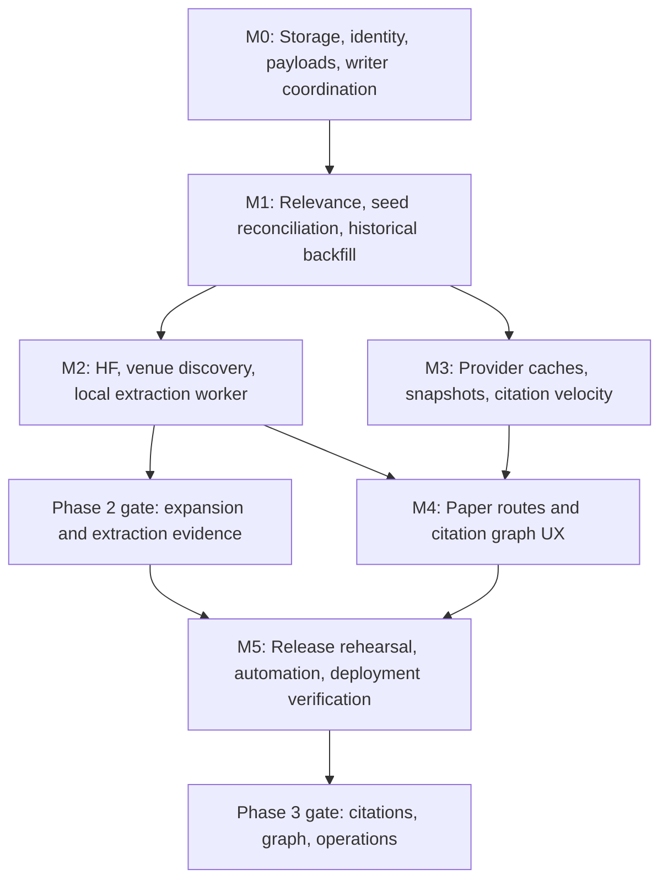

# Sprint Plan: Complete Phases 2 and 3

Planning date: 2026-11-04 (America/Los_Angeles)  
Repository: `mango-jeongi/awesome-gaussian-splatting`  
Verified implementation baseline: `a235a1e` on local `main`  
Status: Ready for implementation; this document defines planned work, not delivered features.

## 1. Outcome and scope

Finish **Phase 2: Multi-Source Literature Expansion** and **Phase 3: Citation Intelligence & Knowledge Graph Network**. Preserve the existing portal's design, filters, themes, keyboard shortcut, and BibTeX workflow while making ingestion complete within declared search boundaries, enrichment auditable, and browsing responsive at 5,000 papers.

The six milestones M0–M5 from [SESSION_SUMMARY.md](../SESSION_SUMMARY.md) remain the execution framework. The README also promises non-arXiv discovery, a local extraction worker, and Semantic Scholar integration. These are included below; merely adding venues to existing arXiv records would not complete that roadmap.

**Planning horizon:** 28–39 engineering days, plus roughly 15% contingency: **32–45 working days, approximately 7–9 weeks for one implementer**. API access, human review, hardware availability, and citation observation windows can extend calendar time. This is a delivery program covering both phases. A conventional first two-week sprint delivers M0 and most or all of M1; it cannot credibly finish the entire scope.

No bulk fetching, worker installation, repository settings changes, commits, pushes, or deployment are performed by this planning task. Existing features and tests were inspected and checked locally. Remote branch freshness, live corpus totals, API secrets, and `msi-raider` availability were not verified.

### Required scope

| Area | Completion means |
| --- | --- |
| Corpus | Restartable historical arXiv ingestion, continuing updates, reviewed relevance decisions, reconciled seeds, and actual discovery of relevant non-arXiv proceedings papers. |
| Community signals | Working Hugging Face discovery and enrichment: upvotes, repository/stars, available Spaces, attributed AI summaries, and explicit unavailable states. |
| Publication metadata | Evidence-backed venue/year/DOI resolution, independent preprint and publication dates, and preprint/proceedings deduplication. |
| Local extraction | Resumable headless worker for teaser candidates and benchmark tables, with source page evidence and reviewed publication of extracted results. |
| Citation intelligence | Authenticated, budgeted OpenAlex enrichment; separate Semantic Scholar observations; TTLs; snapshots; measured citation velocity; transparent trending scores. |
| Graph experience | Stable paper URLs, directed ego-graphs, a bounded global citation view, accessible relationship lists, and accurate coverage reporting. |
| Operations | All four existing workflows migrated, serialized repository writers, offline tests, reproducible artifacts, deploy verification, and rollback instructions. |

Not included: exhaustive coverage of every NeRF paper ever published, full-text semantic search, embeddings, recommendations, accounts, a hosted database, OCR for every scanned PDF, automated cross-paper benchmark rankings, or a repository-wide visual redesign. An external provider's missing record is a coverage limitation; it is not fabricated metadata.

## 2. Verified starting point and corrections to assumptions

| Observation | Verified on 2026-11-04 | Planning implication |
| --- | --- | --- |
| Checkout | Local `main` at `a235a1e`; clean before planning; local tracking reports aligned with `origin/main`. No remote fetch performed. | Start from this exact baseline and recheck upstream before implementation. |
| Existing validation | 13 tests pass; Ruff lint passes; 18 files pass formatting. | Retain these checks and add tests for new failure modes. |
| Canonical corpus | 165 records, schema `1.0.0`, `last_updated=2026-11-03T07:11:06Z`. | Migration starts with a fixed inventory of all 165 IDs. |
| Missing identifiers | 82 lack arXiv IDs; only 18 lack both DOI and arXiv IDs. | Reuse identifiers already present before doing title searches. |
| Citation coverage | 125 records have OpenAlex IDs; 29 directed internal edges. | This is identifier coverage, not proof that all counts or references are fresh. |
| Payload | Both `data/papers.json` and `docs/papers.json` are 429,737 bytes; compact PowerShell serialization is 353,179 UTF-8 bytes. | The historical 11.5 MB projection is plausible for pretty JSON, but is not measured compressed transfer size. |
| Ingestion | arXiv fetches one recent page; HF always returns an empty list. | Pagination, resume checkpoints, revisions, and real HF support remain to be built. |
| Portal | Fetches the entire corpus, searches abstracts, renders every matching card, and jumps to papers through search text. | Pagination alone will not solve initial transfer size or reliable paper routing. |
| Graph builder | Resolves edges through OpenAlex IDs. DOI/arXiv maps are built but not used to resolve references; reverse edges call a linear `db.get`. | Normalize identifier maps and build adjacency in O(V+E). The summary's “fast lookup” does not describe an indexed lookup. |
| Automation | Daily feed, midweek sync, weekly release, and CI exist. Only weekly release has a concurrency group, and that group is Pages-specific. Citation enrichment is not scheduled. | Coordinate every writer, update every path, and run quality checks inside the publishing pipeline. |

Historical estimates from the session summary—4,435 broad arXiv hits, 3,949 tighter hits, and a proposed 59 relevant / 23 off-topic seed split—are **prior-session measurements and classifications, not newly verified counts or automatic acceptance targets**. Recount at the backfill cutoff and review the seed disposition ledger before archiving anything.

The scope is GS/4DGS/2DGS plus explicitly justified NeRF/radiance-field foundations and adjacent methods. The present GS-oriented query does not establish completeness for all NeRF literature. Report coverage against named queries and venue/year inventories, never against an undefined whole research field.

## 3. Delivery order and phase gates



M5's tests, workflow changes, and reporting are implemented throughout the program. They are not postponed until release week. In particular, all writers must understand the new storage format **before** the canonical migration lands. M2 and M3 can interleave after M1; this dependency flexibility does not assume multiple agents or additional staff.

| Milestone | Estimate | Exit evidence | Suggested change boundaries |
| --- | --- | --- | --- |
| M0 | 4–5 days | Migration parity; 5,000-record browser fixture; coordinated workflow paths. | Storage/identity contract; migration; builder/browser compatibility. |
| M1 | 4–6 days | Complete frozen-query ledger; 165-seed disposition map; interrupted-run recovery. | Relevance/overrides; pagination/checkpoints; reviewed corpus import. |
| M2 | 8–11 days | HF fixtures and live sample; venue inventory with non-arXiv discoveries; worker pilot with provenance. | HF; venues/discovery; worker; reviewed enrichment data. |
| M3 | 5–7 days | Provider cache/error tests; freshness report; real dated snapshots; provider-labelled metrics. | Shared OpenAlex client/cache; Semantic Scholar; velocity/trending. |
| M4 | 4–6 days | Route/history tests; graph invariants; browser QA with bounded graph sizes. | Router/detail loader; graph artifacts; graph interface. |
| M5 | 3–4 days | Offline rehearsal; dispatch logs; successful Pages verification; rollback rehearsal. | Release/reporting; operator docs; final data/release candidate. |

One milestone may require several small PRs. Keep algorithm changes separate from bulk metadata changes so reviewers can assess both. Do not mark Phase 2 complete if the worker or non-arXiv discovery is omitted; document any user-approved roadmap reduction explicitly instead.

## 4. Architecture decisions to establish in M0

### 4.1 Canonical records, provider observations, and generated artifacts

Use monthly shards for stable paper metadata and separate stores for changing signals. Avoid rewriting thousands of canonical records every time upvotes or citations change.

```text
config/
  taxonomy.yaml
  sources.yaml                 # Query versions, venue/year inventory, limits, TTLs
  overrides.yaml               # Reviewed include/exclude/merge/metadata overrides
data/
  manifest.json                # Schema version, shard inventory, counts, checksums
  papers/YYYY-MM.json          # Canonical records; month from original publication date
  aliases.json                 # Provider IDs, previous IDs, DOI/arXiv aliases -> stable ID
  archive/papers.json          # Excluded records with reason, evidence, review date
  signals/openalex.json        # Shared work mapping, citations, references, venues
  signals/huggingface.json
  signals/semanticscholar.json
  signals/history/YYYY-MM.json # Dated observations used for velocity
  extraction/jobs.jsonl        # Compact job manifest and results status
  extraction/reviewed.json     # Approved figures/tables and source evidence
docs/data/
  manifest.json                # Public build identity and immutable artifact pointers
  index.<hash>.json            # Compact card/filter data and ID -> detail pointer
  details/YYYY-MM.<hash>.json  # Full records projected for the portal
  search.<hash>.json           # Lazy abstract-search corpus
  graph/manifest.<hash>.json
  graph/adjacency-<bucket>.<hash>.json
  graph/overview.<hash>.json   # Bounded global selection and its induced edges
docs/assets/                  # Reviewed, permitted thumbnails; lazy-loaded
reports/
  coverage.md
  release-checklist.md
  runs/<run-id>.json           # Compact audit summaries, not raw full responses
```

Names above are the proposed contract, not existing files. Introduce storage helpers in `src/storage.py`, identifier/merge helpers in `src/identity.py`, and provider cache/request helpers in `src/extractors/`. Keep `PaperRecord` as the validation boundary. Move changing provider data out of the canonical record model only through an explicit versioned migration and a compatibility projection for existing callers.

Canonical records retain stable IDs, bibliographic fields, full abstract, deterministic summary, taxonomy, source identifiers, provenance, date precision, and reviewed links. Signals carry `provider_id`, `status`, `fetched_at`, `last_attempt_at`, `next_retry_at`, response/schema version, and successful observed values. Status distinguishes `ok`, `not_found`, `ambiguous`, `rate_limited`, and `error`; stale is derived from age and TTL. A successful zero is different from an unobserved value.

Use one shared OpenAlex work response/cache for citations, references, and venues. Do not independently spend three API calls on the same work. Preserve a published DOI separately from the arXiv DataCite DOI and preserve preprint date separately from proceedings date/year.

### 4.2 Stable identity and field ownership

1. Preserve existing canonical IDs when discovering a new arXiv ID, DOI, HF entry, or proceedings version. Resolve new identifiers through `aliases.json`. New records choose versionless arXiv ID, otherwise normalized DOI, otherwise deterministic title-based ID; IDs become stable once assigned.
2. Normalize DOI URLs/case and arXiv URL/version forms centrally. Support legacy arXiv IDs containing a slash. Encode the entire ID in browser routes; never treat raw IDs as filesystem paths.
3. Merge on exact identifier evidence first. Normalized title is candidate evidence, not permission to merge unrelated short titles. Title matches also require author/year agreement or manual adjudication. Record alias collisions and contradictory identifiers as review cases.
4. Respect field ownership: reviewed overrides outrank provider metadata; identifiers and venue evidence outrank regex guesses; HF owns HF signals; OpenAlex and Semantic Scholar own separate citation observations. Deterministic taxonomy runs before any optional LLM enhancement.
5. Re-ingestion must preserve successful observations, reviewed metadata, aliases, and richer fields. Add explicit update policies rather than copying new provider fields into the existing hand-written `upsert` merge and hoping they survive.
6. Never infer a precise date from a seed filename. Store available year/month precision; use a deterministic placement convention and record it. A corrected original publication month moves a record between shards in a single validated transaction.

### 4.3 Atomicity and reproducibility

Write changed shards to a staging directory, validate all records/aliases/checksums, then replace the manifest and commit the full set as one Git change. A failed migration or validation leaves the active store intact. Fail on a missing manifest, shard, or checksum mismatch; do not inherit the current `load()` behavior that treats a missing database as a valid empty corpus.

The builder is deterministic and network-free. A content digest identifies the input snapshot. Do not update corpus timestamps on no-op runs. Public artifacts use immutable hashed filenames referenced by one manifest; retain the previous artifact generation for at least one release to handle cached manifests and to support rollback. Delete obsolete generations only through a bounded, manifest-based cleanup.

### 4.4 Preserve search and control payload growth

The compact index contains ID, title, first-author display, original date/year, category/tag/venue tokens, abbreviated card summary, code availability, signal values/statuses, and a detail pointer. Represent repeated strings through dictionaries if measurements justify it. Full author lists, abstracts, reference arrays, and long AI summaries belong in lazy artifacts.

The current search includes full abstracts. Preserve that behavior: load the abstract search corpus on first nonempty search, show an “expanding search” state, then apply the complete result set. A loaded detail shard must not determine which papers are searchable. BibTeX, full authors, abstracts, and relationship details fetch the necessary detail shard on demand. Cache requests and ignore responses belonging to an obsolete route/search generation.

Default to 50 cards per page with accessible pagination, stable sorting, an explicit total, and page reset on filter changes. Pagination applies after global filtering/sorting. Keep only the active page's cards mounted; a “load more forever” implementation would recreate the DOM bottleneck.

Initial data budget: compact index **target <=750 bytes/record on average** and **hard gate <=4 MB uncompressed at 5,000 records**; record actual gzip bytes separately. Treat the earlier 650-byte estimate as a design target rather than a guarantee. An exceptional single detail shard exceeding 500 KB triggers deterministic subdivision. Do not fetch full details, graph, search abstracts, or thumbnails on the initial catalog request.

## 5. Milestone backlog and acceptance criteria

### M0 — Scale foundations and compatibility

**M0.1: Freeze the baseline and define v2.** Inventory IDs, fields, edge sets, file sizes, known legacy zeros, and source dates. Save a migration report and a recoverable v1 snapshot at a tagged/recorded Git revision during implementation. Define alias, provenance, signal, and archive schemas before modifying ingestion.

**M0.2: Implement storage and migration.** Add `migrate`, `validate`, and `build` support for manifests/shards; keep a temporary read-only legacy import path. Copy all 165 records losslessly, preserve field values through a compatibility projection, and map legacy signal observations to unknown freshness rather than inventing fetch timestamps. Do not automatically equate legacy zero citations with a verified zero. Add dry-run/parity reporting and explicit rollback instructions.

**M0.3: Migrate writers before cutover.** Update CLI defaults, seed, retag, citations, graph, builder, tests, and all workflows together. Use explicit generated path allowlists including deletions. Add the shared writer concurrency group described in M5 now. Avoid running the old scheduled writers against v2.

**M0.4: Deliver compact browser loading.** Build the manifest/index/detail/search projections, pagination, cached loaders, network error/retry states, and compatibility tests. Retain existing themes and layout. Maintain README category anchors; keep its existing 60-row category cap but label truncated lists and link to the full filtered portal rather than implying the README lists every record.

**Exit gate:** every baseline ID/field/edge is accounted for; missing/corrupt shards fail; migration rerun is harmless; interrupted writes retain the prior valid store; a no-op build produces identical bytes; a 5,000-record fixture passes payload and portal checks; all scheduled writer paths are compatible.

### M1 — Relevance, seed reconciliation, and corpus completeness

**M1.1: Create a reviewable relevance policy.** Add `src/relevance.py` with `include`, `exclude`, and `review` outcomes, reasons, and rule version. Use strong GS terms, contextual acronym checks, and explicit curated foundations. Do not blanket-exclude medical, thermal, SAR, or robotics work: those are valid GS applications in the taxonomy. Do not admit generic ultrasound or unrelated uses of “Gaussian” just because they share a category keyword. Inclusion overrides and explicit exclusions must be deterministic; conflicting overrides fail validation.

Build a manually labelled fixture of at least 100 candidates across broad-query hits, acronym collisions, GS medical/sensor applications, NeRF foundations, and clear negatives. Target >=95% precision and >=95% recall on that fixture; report the sample composition and avoid claiming population-wide accuracy. Ambiguous cases enter the review queue rather than disappearing.

**M1.2: Reconcile all 165 baseline records.** Produce one ledger row per old ID: retained, merged into ID, archived with reason, or unresolved review. For the 82 without arXiv IDs, start with existing DOI/OpenAlex evidence, then strong title/author/year matching. Resolve truncated titles only with source evidence. Verify the historical 59/23 split instead of enforcing it. Archival preserves the record and a dated reason; the original local PDF library is untouched.

**M1.3: Add resumable historical pagination.** Record the literal broad query, narrower comparator query, policy version, cutoff timestamp, and query digest. Discover the earliest matching submission rather than assuming all matches begin in 2023. Enumerate monthly submitted-date slices through the cutoff; use inclusive API bounds with client-side half-open interval filtering, stable ordering, full pagination, ID deduplication, and per-slice totals. Subdivide an overflowing slice. Detect malformed/error Atom entries, repeated pages, short pages inconsistent with totals, and request failures; never mark those slices complete.

Checkpoint after validated page persistence: query digest, interval, cursor/offset, retrieved IDs/count, expected count, retries, and completion status. Resume from persisted state and replay the boundary page safely. A changed query or relevance policy invalidates the appropriate checkpoint rather than silently mixing runs.

**M1.4: Replace capped daily ingestion with an update window.** Track a successful watermark and fetch every page in a rolling seven-day overlap using updated timestamps where supported; always deduplicate by versionless ID. This catches revisions to old papers as well as new submissions. Advance the watermark only after durable writes and validation. After a longer outage, resume from the old watermark instead of limiting the recovery to seven days. Keep a weekly reconciliation pass as a second defense against source indexing delays.

The arXiv request scheduler must enforce one connection and at least three seconds between requests, including successful pages, across backfill/daily/worker traffic under our control. The existing delay only between failed attempts is insufficient for pagination. Follow [arXiv's API terms](https://info.arxiv.org/help/api/tou.html) and [paging/query documentation](https://info.arxiv.org/help/api/user-manual.html). Persist response metadata and bounded retries; do not launch concurrent API crawlers.

**Exit gate:** every frozen query slice is reconciled or explicitly unresolved; each unique candidate has one disposition; every old ID is mapped; restart/replay and >60-arrival fixtures lose no records; revision fixtures update an old record; repeated ingestion is a no-op. Report fetched, unique, included, excluded, merged, review, and failed counts separately. Approximately 4,400 is a sizing assumption, never a required inclusion quota.

### M2 — Multi-source expansion and local extraction

**M2.1: Implement Hugging Face.** Replace the stub with a shared HTTP adapter for daily discovery and per-paper enrichment. Capture real response fixtures before fixing the field contract: nested paper structure, optional/missing values, repository, stars, upvotes, available Spaces, summary, and timestamps. HF links to an arXiv paper become aliases/source observations, not duplicate canonical papers. HF-only candidates still pass relevance review.

Store HF summaries as attributed provider text with fetch time; do not replace the abstract or silently label an AI summary as an author claim. Distinguish no HF entry from API failure. Preserve reviewed official code URLs; treat a returned repository as provider evidence until ownership is confirmed. Return only Spaces explicitly linked by evidence, not guessed URLs. A legitimate absence is acceptable.

Default refresh policy: 24 hours for recently active papers, seven days for older matched entries, and seven days for confirmed misses. Apply a bounded discovery lookback and resumable enrichment queue instead of probing all 5,000 IDs daily. Honor rate-limit headers and backoff. HF documents its API reference through the [official Hub API page](https://huggingface.co/docs/hub/api); endpoint shapes from the prior session still require a small live contract check before implementation is finalized.

**M2.2: Separate venue enrichment from proceedings discovery.** Add `src/extractors/venues.py` and a discovery adapter, using shared OpenAlex work metadata, DBLP publication search, and official proceedings records where available. OpenAlex locations can provide publication evidence, but the mere presence of a repository location does not prove peer review. Require matched identity plus conference/journal evidence; store source URL, source ID, match method, venue/year, and confidence. Regex author comments remain provisional and cannot invent a conference year from the preprint year.

Freeze a venue/year inventory in `config/sources.yaml`: CVPR 2020–2026; ICCV 2021/2023/2025; ECCV 2020/2022/2024/2026; SIGGRAPH and NeurIPS 2020–2026. Separate main proceedings from workshops. Each cell is pending, crawled, reconciled, or unavailable with evidence; incomplete editions are labelled partial. Query all pages and compare against a source-provided inventory where feasible. Apply the same topic policy to newly discovered papers. A paper can be relevant without an arXiv record.

Use the [DBLP publication search API](https://dblp.org/faq/13501473.html) for discovery and identifiers, with explicit pagination and venue/year boundaries. Use official records such as [CVF proceedings](https://openaccess.thecvf.com/CVPR2025) to verify publication attribution. Avoid promising exhaustive publisher coverage from OpenAlex alone. Preserve stable aliases when a non-arXiv record later receives an arXiv link. Capture venue ambiguities and edition gaps in the report.

**M2.3: Implement the local extraction worker promised by the README.** Add a separate optional dependency group for PDF extraction and `src/workers/` commands for queue generation, a single bounded worker pass, result validation, and reviewed import. Establish the queue/result protocol locally before contacting `ssh msi-raider`; verify hardware/access at implementation kickoff, not by assuming the hostname is available.

Jobs are keyed by canonical ID, source PDF digest, and extractor version. States: queued, leased, succeeded, failed/retryable, and review-required. Leases expire after worker loss; retries do not duplicate output. Set per-file size/page/time limits and a maximum job budget. Save page number, crop bounding box, caption, table heading, dataset/split/metric/unit context, raw extracted value, and parser confidence. Missing units or ambiguous row/column associations force review. Do not generate a leaderboard from incomparable tables.

Use `uv` and the mandated local SSD environment; keep temporary PDFs and heavy parser caches off Google Drive. The remote worker needs an explicitly configured local SSD environment appropriate to its OS. Run under a documented service or scheduler with restart/resume behavior; demonstrate that a job survives a client disconnect and that a killed job is recovered once. Import results through the same validated repository writer rather than allowing a daemon to push independently.

For teaser images, select a sourced figure candidate, preserve caption/page attribution, and publish only reviewed assets whose reuse basis is recorded. Unclear reuse remains a source link. The arXiv metadata permissions do not automatically grant redistribution of paper figures; [arXiv's terms](https://info.arxiv.org/help/api/tou.html) distinguish metadata from e-print content. This is part of producing the requested thumbnail feature correctly.

Pilot acceptance: at least 12 relevant papers across six taxonomy categories, including multi-column/vector PDFs and one extraction failure case. Process at least six benchmark-bearing papers and 30 manually checked numeric cells: every accepted cell must match its source; inaccurate output is corrected or rejected. All unreviewed tables stay marked as extracted candidates. After the pilot, scan all included records for eligibility and persist each as processed, queued, unavailable, or unsupported. Parser perfection on every historical PDF is not a completion criterion; an operational queue and explicit coverage are.

**Phase 2 gate:** M0/M1 checks pass; HF discovery/enrichment runs; every configured venue/year cell has a disposition; real non-arXiv candidates are discovered and correctly merged or included; all seed decisions are reviewed; the worker runs headlessly with recovery and a reviewed pilot. Publish source-specific coverage and unresolved queues. Hardware unavailability blocks this full gate while other milestones continue.

### M3 — Citation intelligence, freshness, and ranking

**M3.1: Build a shared OpenAlex client and typed cache.** Use `httpx` consistently, exact normalized identifier mapping, bounded batches, explicit timeouts, exponential backoff with jitter, `Retry-After`, and sanitized logs. Eliminate substring DOI matching. Match arXiv DOI and publication DOI candidates to a canonical work; preserve multiple evidenced work aliases where providers split versions. Weak title matches become ambiguous instead of taking the first result.

Read `OPENALEX_API_KEY` from the environment/Actions secrets. Prefer authorization headers to avoid query-string leakage. Stop or defer when the account budget is exhausted; retain successful cache entries. Do not retry authentication failures indefinitely. Verify the documented limits at implementation kickoff: the current [OpenAlex authentication reference](https://help.openalex.org/api/authentication/) describes keyed budgets, rate-limit reporting, and limits on batched filters. Older “polite pool” assumptions are not a sufficient operating policy. Start with the existing conservative batch size of 40 and validate result pagination rather than maximizing limits.

Refresh defaults: new/unmapped papers daily for seven days, successful recent work every seven days, older work every 30 days, confirmed misses after seven days. Errors use backoff and do not update successful `fetched_at`; a successful empty reference list must replace an old list, while a failed response must not erase it. Cache freshness and retry eligibility are separate clocks. Add a cache-only mode and an explicit refresh-due queue with request/time/budget ceilings.

**M3.2: Keep Semantic Scholar observations separate.** Add `src/extractors/semanticscholar.py`, keyed by exact arXiv/DOI/provider identifiers, with optional `SEMANTIC_SCHOLAR_API_KEY`, provider ID, citation count, influential citation count when returned, references, and fetch status. Follow the [official API tutorial](https://webflow.semanticscholar.org/product/api/tutorial) for batch requests, `x-api-key`, and throttling; begin at no more than one request per second unless the actual account permits more.

OpenAlex stays the default global-citation sort. Offer an explicit provider selector or clearly labelled fallback. Never sum counts across providers, splice their time series, or call OpenAlex observations “influential citations.” Unobserved influential counts display unavailable. Keep graph edges source-labelled; the initial graph uses OpenAlex, with Semantic Scholar reference supplementation only when identity and provenance are verified. Full Phase 3 requires one validated live Semantic Scholar sample; absent access is an explicit dependency, not a reason to pretend the adapter is complete.

**M3.3: Start historical observations early.** On the first successful M3 run, save dated counts and begin scheduled sampling; develop the interface while the time series matures. Keep daily observations for recent papers and weekly observations for older papers, with a rolling 13-month history. Deduplicate observations by provider/paper/date. A cache import is not a historical observation unless its actual timestamp is known.

For two observations from the same provider at times t0 and t1 at least seven days apart:

```text
elapsed_days = (t1 - t0) / 86400
raw_velocity = (citations(t1) - citations(t0)) / elapsed_days
```

Prefer the observation nearest 30 days earlier within a 7–45-day eligible window; show the actual window. If counts decrease, retain the raw delta for audit, flag a provider correction, and use zero positive momentum for ranking. One snapshot, stale current data, or an identity remap without comparable observations means velocity is unavailable. Annual `counts_by_year` is not a substitute for a measured rolling delta. At least seven calendar days of real observations are needed for the first non-fixture velocity evidence.

**M3.4: Define transparent trending.** Restrict to papers <=90 days old with eligible, non-stale signals. Within that candidate set compute percentile ranks (midranks for ties) of nonnegative citation velocity and HF upvotes, then:

```text
signal_mix = 0.7 * velocity_percentile + 0.3 * upvote_percentile
trend_score = 100 * signal_mix * 2 ** (-age_days / 30)
```

If one component is unavailable, renormalize weights over available components and label the score partial. No components means no score. Always show coverage class and observation dates; sort complete scores ahead of partial scores by default and offer a filter. Use original date and stable ID as deterministic tie-breakers. Store formula/version/weights in configuration and test small hand-calculated examples. This is a discovery ranking, not a scientific quality metric. GitHub stars remain a displayed signal for this sprint rather than another arbitrary ranking term.

**Exit gate:** exact/fuzzy conflict tests, stale-on-error preservation, valid-zero handling, successful-empty references, TTL boundaries, auth failure, retry/budget exhaustion, and cache-only operation pass; all included papers have a provider-attempt disposition; live response samples are matched correctly; two real dated observations support at least one displayed velocity. Single-snapshot papers remain honestly unavailable. Thirty-day scores mature later without delaying the initial release or fabricating history.

### M4 — Stable paper pages and bounded citation graphs

**M4.1: Add hash routing.** Support `#/paper/<encoded-id>`, `#/graph`, and a catalog route preserving query/filter/sort/page state. Resolve aliases before fetching details. Deep links must work on the GitHub project Pages base path without server rewrites. Handle legacy slash-containing IDs, DOI colons/slashes, unknown IDs, archived records with disposition, failed detail requests, and missing graph coverage. Browser back/forward restores list position and filters. Relationship clicks navigate directly rather than changing the text search and accidentally inheriting a year/code filter.

**M4.2: Build a correct graph projection.** Use maps for canonical/provider IDs and deduplicated sets for edges. Direction is **citing paper -> referenced paper**. Normalize full/short OpenAlex IDs and evidenced DOI/arXiv references; never create edges from title similarity alone. Exclude archived nodes from the active graph. Emit provenance, corpus/build digest, matched/unmatched reference counts, adjacency buckets, and a bounded overview. Self-edges and duplicate edges are invalid; unresolved external references remain in coverage statistics rather than becoming broken nodes.

**M4.3: Render ego-graphs and the global overview.** Load a pinned Cytoscape.js version only when entering a graph view. Follow its [official API documentation](https://js.cytoscape.org/) and keep a text relationship list usable if the graph library fails. Default ego view: one hop, maximum 80 nodes/200 edges. Optional two-hop view: maximum 150 nodes/400 edges with deterministic selection and explicit omitted counts. Clicking a node opens its canonical paper route.

The global view selects up to 300 papers by in-corpus incoming citations, then global OpenAlex citations, then stable ID; retain only edges between selected nodes and cap rendered edges at 1,200. Label it “most cited in this corpus” rather than claiming an objective list of seminal work. Provide year/category filters and a seeded deterministic layout with a bounded runtime; stop old layouts on route changes. Keep edge direction visible, use a legend, provide keyboard access to equivalent lists, and handle disconnected/unmapped papers with clear empty states.

**Exit gate:** graph edge direction/inversion is correct; all graph endpoints resolve to active IDs; graph counts agree with relationship lists; route, refresh, aliases, back/forward, empty states, and mobile layouts pass browser QA; no uncapped 5,000-node visualization is loaded. Citation lineage is explicitly partial and does not claim causal influence or scientific superiority.

### M5 — Automated operation and release

**M5.1: Serialize every repository writer.** Daily ingestion, midweek merge, weekly release, manual backfill, and worker-result import share one repository-wide concurrency group with `cancel-in-progress: false`. Re-fetch branches after acquiring the slot, verify expected parents, and use ordinary pushes. If a branch changed unexpectedly, fail/retry safely instead of overwriting it. Push synchronization of `main`/`feed` as an atomic multi-ref update where supported; otherwise reconcile explicitly after a partial push failure. No force pushes.

GitHub concurrency does not guarantee a FIFO queue and can replace pending runs; run semantics must remain correct if an intermediate scheduled run never executes. The watermark and resumable queues recover the gap. See [GitHub concurrency](https://docs.github.com/en/actions/concepts/workflows-and-actions/concurrency).

**M5.2: Update responsibilities across all workflows.**

| Workflow | Planned behavior |
| --- | --- |
| `ci.yml` | Frozen dependency install, Ruff lint/format, fixture-based tests, strict store/alias validation, deterministic build/parity checks, payload budget and graph integrity tests. No live API dependency. |
| `daily-feed.yml` | Complete updated-window arXiv paging; bounded HF discovery/refresh; deterministic enrichment by default; persist watermarks; validate and build before committing generated paths to `feed`. Start dated observations on a bounded queue if configured. |
| `midweek-sync.yml` | Merge compatible code/data, refresh a bounded due-signal queue, graph/build/validate and full checks; synchronize branches without dropping feed updates. No Pages deployment, preserving current cadence. |
| `weekly-release.yml` | Reconcile source inventories, refresh due OpenAlex/S2/HF queues within budgets, import reviewed worker output, graph/build/report, full checks, immutable release artifact, Pages deployment, then live smoke verification. |
| Manual operations | Backfill/worker-import dispatch uses the same writer lock and storage version; checkpoints survive interrupted runs. Unreviewed extractions never auto-publish. |

Keep existing UTC schedules unless a later product decision changes release cadence. Remove the unsupported blanket `<72h` availability claim: midweek sync does not deploy Pages, and elapsed time from ingestion to `main` differs from time to public portal deployment. Report source freshness, branch freshness, and Pages freshness separately. Weekly release is the current public publication cadence.

Run checks inside each mutating workflow before pushing. A push made with `GITHUB_TOKEN` does not generally trigger another push workflow, so it is unsafe to rely on a later CI run to catch invalid generated data. This behavior is documented by [GitHub workflow triggering](https://docs.github.com/en/enterprise-cloud%40latest/actions/how-tos/write-workflows/choose-when-workflows-run/trigger-a-workflow). Avoid using `[skip ci]` as a substitute for validation. Use the same validation command set in all workflows, including formatting.

Use `uv sync --frozen --all-groups` in CI and the prescribed SSD environment locally. Retain verified existing action versions unless a separately tested dependency update is needed. Map dispatch inputs through environment variables and validate numeric/range values. Make a failed provider refresh visible in the workflow summary even when cached publication can proceed. Required-source failures leave coverage incomplete and do not advance their watermark.

**M5.3: Report and observe.** Each run records input/build digest, source query/interval, candidate dispositions, merged/archive/review counts, requests/retries/errors, cache hits, successful observation ages, unresolved work IDs, graph nodes/edges, bytes, duration, and extraction coverage. Reports contain aggregate evidence and IDs, never tokens or full sensitive request URLs. A no-change run may upload a run report without making a data commit.

`reports/coverage.md` separates query-complete discovery, relevance review completion, arXiv/non-arXiv counts, venue/year gaps, source match rates, citation freshness, velocity eligibility, graph connectivity, and reviewed figure/table coverage. Denominators are explicit. An unmapped paper has unknown citation coverage, not zero influence.

**M5.4: Rehearse, release, and verify.** Test a fixture-only run first, then a small live canary, then resume the full backlog. Perform two successive ingestion runs to prove replay/no-op behavior; rehearse simultaneous workflow triggers without lost writes; test an exhausted provider budget and a missing shard. Capture one midweek and one weekly manual dispatch result during implementation.

Separate the release candidate build/tag from successful deployment status. Verify that an already existing weekly tag identifies the exact intended commit; do not silently reuse a tag pointing elsewhere. Use ISO week-year when generating week tags and test the December/January boundary. A failed release operation must be reported instead of hidden by `|| true`. Record the deployed build digest and only mark the release successful after the public manifest and routes pass checks. A retry redeploys the same candidate without changing its inputs.

Rollback: redeploy the previous immutable Pages artifact, then revert the migration/data change through normal reviewed Git history if necessary. Never rebuild an old portal from the latest incompatible data. Document the exact prior build digest and rehearse rollback with a local/staging fixture before production cutover.

## 6. Verification matrix and measurable release gates

| Area | Required cases | Acceptance |
| --- | --- | --- |
| Store/migration | All 165 baseline records; corrupt/missing shard; duplicate IDs; alias collision; month correction; interrupted write; no-op rerun. | No unexplained loss or field change; strict failure on corruption; deterministic bytes. |
| Relevance/identity | GS medical/thermal/SAR; unrelated ultrasound; acronym collisions; truncated title; preprint/proceedings; contradictory DOI. | Labelled-fixture targets met; ambiguous candidates reviewed; stable aliases. |
| arXiv | >60 new hits; paginated month; overlapping bounds; repeated page; source count mismatch; old-paper revision; interruption. | Complete interval accounting and safe watermark; enforced successful-request pacing. |
| Provider adapters | Valid zero; missing/null fields; not found; 401/403/429/5xx; partial batch; malformed response; exhausted budget. | Successful cache preserved; fresh/missing/error distinct; bounded retries; no secret logging. |
| Citations | Corrected lower counts; duplicate snapshot; first snapshot; 7-day boundary; remapped identity. | Hand-calculated velocity/ranking matches; no invented history; provider series kept separate. |
| Graph | Mixed identifiers; external reference; self/duplicate edge; archive; disconnected node. | Direction, counts, and all active endpoints valid; deterministic bounded artifacts. |
| Worker | Duplicate job; lease expiry; parser timeout; invalid crop; incorrect unit; disconnect/restart. | One accepted result per job digest; review evidence preserved; pilot numeric values exact. |
| Portal | Deep link at project base; ID slash/quotes; alias; back/forward; lazy-load failure; abstract search; BibTeX; mobile/theme. | Existing controls work; complete results independent of cached shards; no console errors. |
| Automation | Concurrent writers; upstream advance; skipped pending run; existing tag; provider outage; repeated dispatch. | No lost feed changes; recoverable checkpoints; visible degraded state; deploy matches candidate digest. |

Performance is a **proposed release budget**, not measured current performance. Use a fixed 5,000-record fixture and the largest expected graph fixture. Record browser/version, hardware, viewport, and throttling configuration. Run five cold loads and report median and slowest result; do not label five observations a robust p95 estimate.

- Catalog first usable page: median <=3 seconds under desktop Chromium, 4x CPU slowdown, 10 Mbps down / 1 Mbps up, 100 ms latency; record the slowest run.
- Warm local filtering/sorting: median <=150 ms from input to painted active page; no unbounded full-result DOM.
- Compact index: <=4 MB uncompressed at 5,000 records, with actual gzip transfer reported. Separate index JSON, HTML/JS/CSS, and image bytes.
- Deep-linked detail: <=1 second after the index is loaded under the same network profile; show immediate loading state.
- Bounded ego-graph: usable within two seconds after required data arrives, with a stopped layout and accessible text fallback.
- Offline 5,000-record build/validate/graph: <=60 seconds on the recorded reference machine. Optimize measured hot paths only; the first known fix is indexed graph inversion.

Do not claim those targets are passed until recorded browser/build evidence exists. If a target is missed, narrow the bottleneck, adjust the implementation, and rerun the affected check before changing the budget.

## 7. Local environment and planned CLI surface

All Windows Python work follows the workspace's `uv`/SSD mandate:

```powershell
Set-Location -LiteralPath 'G:\My Drive\Papers\awesome-gaussian-splatting'
$env:UV_PROJECT_ENVIRONMENT = 'C:\Users\mingu\.venvs\papers'
uv sync --frozen --all-groups
uv run ruff check .
uv run ruff format --check .
uv run pytest -v
uv run python -m src.cli validate
```

The existing CLI offers `ingest`, `retag`, `build`, `seed`, `validate`, `citations`, and `graph`. New commands/options below are **implementation targets and must not be copied as working commands yet**:

| Proposed operation | Contract |
| --- | --- |
| `migrate --dry-run` / `migrate` | Show parity/disposition, write v2 atomically, retain rollback evidence. |
| `backfill --until ... --resume` | Frozen-query, interval-ledger ingestion with bounded requests and safe checkpoints. |
| `ingest --since ... --no-llm` | Complete overlap window/revision ingestion, not a single capped page. |
| `refresh-signals --provider ... --due --max-requests ...` | Resumable budget-limited provider queue with typed outcomes. |
| `graph --cache-only` | Deterministic O(V+E) graph build from validated observations. |
| `coverage` | Emit source/interval/review/freshness/graph/extraction reports. |
| `worker enqueue`, `worker run --once`, `worker import-reviewed` | Digest-based local jobs, bounded lease/retry, validated reviewed publication. |

Validate argument names during implementation and update CONTRIBUTING plus the README generator together. Keep deterministic, no-LLM operation the normal backfill/CI path; do not send thousands of abstracts through optional LLM providers by default.

## 8. Dependencies, risks, and decisions

| Dependency/risk | Action and owner | Effect if unresolved |
| --- | --- | --- |
| OpenAlex credential/budget | Repository maintainer supplies an active secret; implementer verifies a sanitized canary and budget handling. | Cache-only development continues; live enrichment completion remains open. |
| Semantic Scholar throttling/access | Maintainer provides a key if needed; implementer verifies batch contract and a small live sample. | Adapter tests continue; full Phase 3 source-integration gate remains open. |
| HF schema/field drift | Implementer captures live fixtures, uses tolerant optional fields and schema diagnostics. | Missing optional fields are reported; no fabricated Spaces/stars/summaries. |
| Seed decisions/ambiguous merges | Implementer creates evidence ledger; maintainer adjudicates uncertain records. | Exclusion/merge queue remains visible; no destructive guessing. |
| `msi-raider` access/service support | Maintainer confirms access/SSD location; implementer verifies headless restart and result import. | Other work continues; full Phase 2 worker gate remains open. |
| Figure reuse/table quality | Store source evidence and review disposition with each candidate. | Link-only or candidate-only output; no unsupported public asset/value. |
| Broad query drift or incomplete venues | Freeze cutoff/query/inventory versions and reconcile per slice/cell. | Report incomplete coverage; avoid an unsupported completeness claim. |
| Single-snapshot velocity | Start snapshots as soon as M3 cache exists and keep sampling during UI work. | Display unavailable until >=7 days of genuine observations exist. |
| Storage cutover with active workflows | Land compatible writers and shared concurrency before migration. | Delay cutover; do not run mixed-format writers. |
| Work exceeds first two weeks | Close M0/M1 first; keep M2–M5 estimates and phase gates visible. | Extend delivery window; do not rename partial delivery “both phases complete.” |

No dependency above requires a clarification before this plan is useful. Credentials, hardware access, and genuinely ambiguous record judgments are implementation dependencies to collect at kickoff while independent work proceeds.

## 9. First two-week sprint and final completion checklist

### First ten working days

| Day | Work | Reviewable result |
| --- | --- | --- |
| 1 | Recheck upstream, inventory baseline, pin contracts, check provider/worker access without bulk jobs. | v2 schema/identity decision, baseline inventory, access ledger. |
| 2–3 | Storage adapter, strict validation, aliases, reversible migration, writer-path/concurrency changes. | Tested migration PR with exact parity report. |
| 4–5 | Compact public artifacts, pagination/lazy details, full abstract-search preservation. | 5,000-record fixture and browser/payload report; M0 gate. |
| 6 | Relevance policy, labelled sample, seed disposition evidence. | Review queue and override schema; no automatic 23-record deletion. |
| 7–8 | Historical pagination/checkpoints and update watermark/revision support. | Replay/interruption/>60-results tests; source query manifest. |
| 9 | Small live canary followed by resumable frozen-cutoff backfill if canary passes. | Per-slice progress/disposition ledger. |
| 10 | Reconcile counts, review seed decisions, inspect taxonomy spread and storage sizes. | M1 gate or explicit remaining slices/review cases; M2 kickoff packet. |

This sequence is conditional on evidence, not an instruction to skip a failing gate to stay on a date. Begin M3 sampling immediately once the provider cache contract is ready, even if M2's worker continues longer.

### Both phases complete only when

- [ ] Every baseline record has an auditable disposition; canonical IDs and legacy links resolve.
- [ ] v2 storage and all writers are deployed compatibly; deterministic builds and rollback pass.
- [ ] Every frozen arXiv query slice and venue/year inventory cell has a reconciled status; relevance review gaps are published.
- [ ] HF discovery and signal enrichment work with real sampled responses and typed unavailable/error states.
- [ ] Non-arXiv proceedings discovery runs and publication metadata has source evidence.
- [ ] The headless extraction worker resumes safely, passes the reviewed pilot, and exposes queue/coverage status.
- [ ] OpenAlex and Semantic Scholar observations are source-labelled, cached, budgeted, and exercised on live samples.
- [ ] Real dated snapshots support measured velocity; unavailable cases and provisional windows remain explicit.
- [ ] Stable routes, relationship lists, ego-graphs, and the bounded overview pass desktop/mobile QA.
- [ ] Payload, interaction, graph, and build budgets have recorded measurements.
- [ ] Fixture tests and full validation pass inside publishing workflows; competing writers preserve changes.
- [ ] A release candidate is deployed and its public manifest/routes match its digest; rollback is documented and rehearsed.
- [ ] README roadmap wording, generated documentation, CONTRIBUTING, and the session summary reflect actual completion and remaining coverage limitations.

Planning validation completed now: local baseline inspection, 13 passing tests, Ruff lint, and formatting checks. All new acceptance criteria above remain future implementation work.
